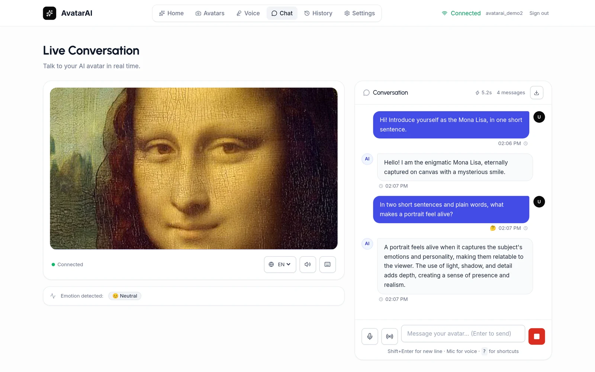
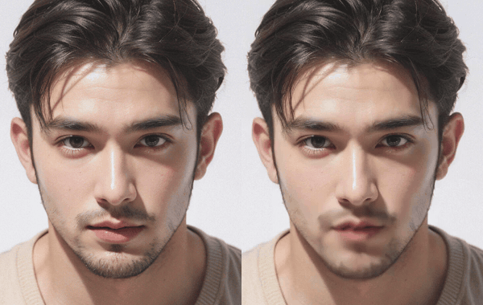
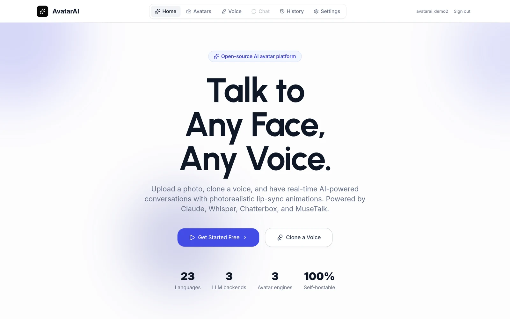
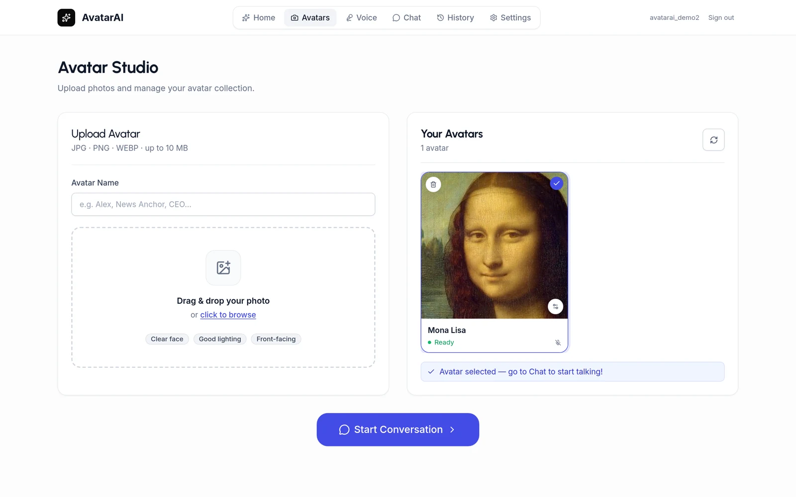
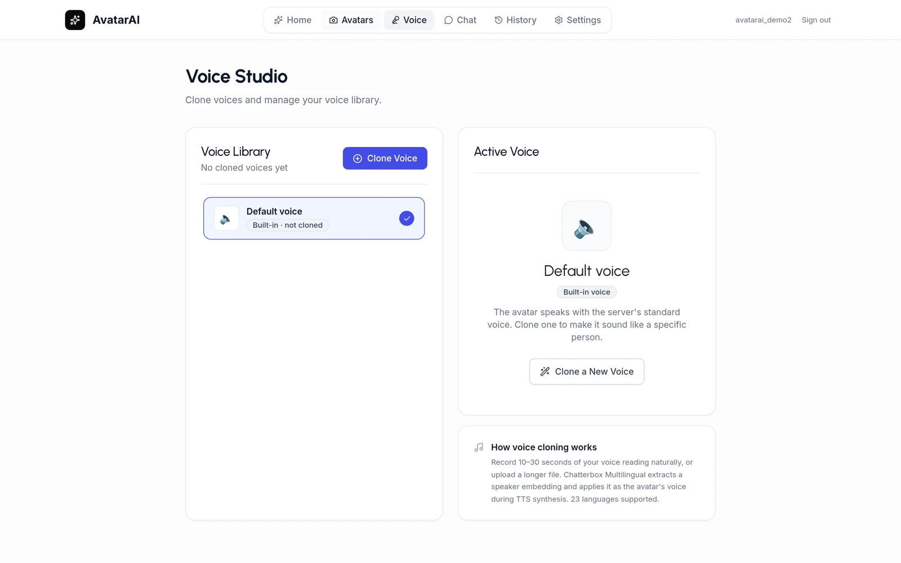
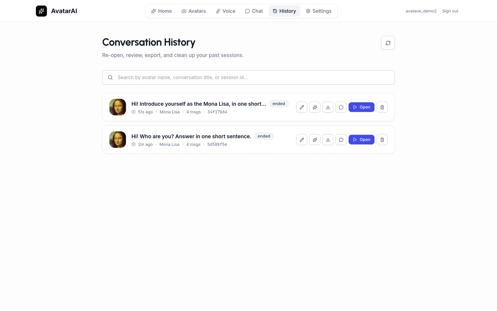
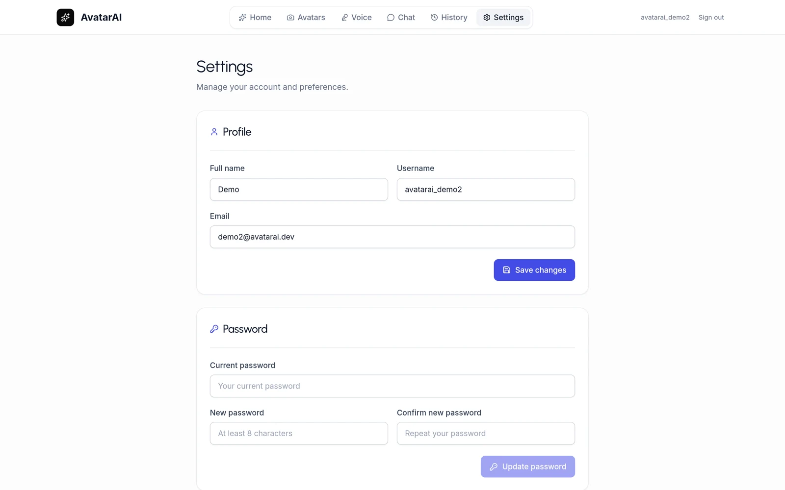

<div align="center">

<h1>🎭 AvatarAI — Real-Time AI Avatar Platform</h1>

<p><strong>Upload a photo · Clone a voice · Talk to any face in real time</strong></p>

<p>
  <a href="https://github.com/PunithVT/ai-avatar-system/stargazers"></a>
  <a href="https://github.com/PunithVT/ai-avatar-system/forks"></a>
  <a href="https://github.com/PunithVT/ai-avatar-system/issues"></a>
  <a href="LICENSE"></a>
  <a href="https://github.com/sponsors/PunithVT"></a>
</p>

<p>
  
  
  
  
  
  
  
  
</p>

<p>
  <a href="#-screenshots">Screenshots</a> ·
  <a href="#-quick-start">Quick Start</a> ·
  <a href="#-features">Features</a> ·
  <a href="#-architecture">Architecture</a> ·
  <a href="#-gpu--aws-deployment">GPU / AWS Deploy</a> ·
  <a href="#-api-reference">API</a> ·
  <a href="#-roadmap">Roadmap</a>
</p>

> **The most complete open-source AI avatar / digital human system.**
> Real-time talking-head lip-sync · Zero-shot voice cloning · Multi-LLM · Runs 100% locally or on AWS.

<br/>

<a href="docs/images/chat.webp"></a>

<sub>A live conversation: the avatar speaks each sentence as the model streams it. Portrait: <em>Mona Lisa</em>, Leonardo da Vinci (public domain).</sub>

</div>

---

## 🎬 What is AvatarAI?

AvatarAI is an open-source, production-ready platform for building **photorealistic AI avatar conversations**. Upload any face photo, clone a voice from a 10-second audio clip, and have a real-time conversation — with **lip-sync video generated on every single response**.

<div align="center">



<sub><strong>One photo in, a talking face out.</strong> Left: the uploaded still. Right: frames generated by this repository's MuseTalk pipeline from that still and a speech clip — unedited output.<br/>Sample face from the MuseTalk project's demo assets (MIT).</sub>

</div>

```
[mic] → Whisper STT → Claude / GPT / Ollama (streaming) → Chatterbox TTS → MuseTalk lip-sync → [video]
                              < 2–4 s to first video chunk on AWS GPU >
```

**What makes AvatarAI different:**
- 🎤 **Zero-shot voice cloning** — 10 seconds of audio is all you need (Chatterbox Multilingual)
- 🎭 **Any face, any language** — upload a JPEG, pick from 23 languages, start talking
- ⚡ **Token-streaming pipeline** — the LLM streams live tokens while TTS + lip-sync run per sentence; the first video chunk plays before the model finishes its reply
- ✋ **Barge-in** — speak (or hit stop) mid-reply and the avatar yields instantly, like a real conversation
- 🔒 **100% local mode** — local storage, local Whisper, local LLM via Ollama: nothing leaves your machine
- 🔌 **Multi-LLM** — Claude (with prompt caching), GPT-4o, or any local model via Ollama / vLLM / LM Studio
- 🚀 **AWS GPU deployment** — one-command deploy to `g5.xlarge` for true real-time (~30 FPS)
- 🏗️ **Production-grade** — JWT + httpOnly-cookie auth, per-user rate limiting, Postgres + Alembic, S3/CloudFront, Prometheus, CI, a real test suite — the only project in this niche you can ship as a product, not just a demo

---

## 📸 Screenshots

<table>
  <tr>
    <td width="50%" align="center">
      <a href="docs/images/home.webp"></a>
      <br/><sub><strong>Home</strong> — start a conversation or clone a voice</sub>
    </td>
    <td width="50%" align="center">
      <a href="docs/images/avatars.webp"></a>
      <br/><sub><strong>Avatar Studio</strong> — upload a photo; the face is detected and cropped for you</sub>
    </td>
  </tr>
  <tr>
    <td width="50%" align="center">
      <a href="docs/images/chat.webp"></a>
      <br/><sub><strong>Live conversation</strong> — type, hold to talk, or go hands-free; interrupt at any time</sub>
    </td>
    <td width="50%" align="center">
      <a href="docs/images/voice.webp"></a>
      <br/><sub><strong>Voice Studio</strong> — record 10–60 s to clone a voice, then assign it to an avatar</sub>
    </td>
  </tr>
  <tr>
    <td width="50%" align="center">
      <a href="docs/images/history.webp"></a>
      <br/><sub><strong>History</strong> — reopen, rename, summarise or export past conversations</sub>
    </td>
    <td width="50%" align="center">
      <a href="docs/images/settings.webp"></a>
      <br/><sub><strong>Settings</strong> — profile and password; guests can turn their session into an account</sub>
    </td>
  </tr>
</table>

<sub>Screenshots are of the real app running against a real backend. To retake them after a UI change, see <a href="docs/images/README.md">docs/images/README.md</a>.</sub>

---

## ⚔️ How AvatarAI compares

| | **AvatarAI** | Duix-Avatar | Linly-Talker | AIAvatarKit |
|---|---|---|---|---|
| Real-time conversation | ✅ WebSocket streaming | ❌ offline video gen | ✅ (Gradio / WebRTC spin-off) | ✅ |
| Lip-sync video | ✅ MuseTalk V1.5 | ✅ proprietary models | ✅ multiple engines | ❌ (drives external avatars) |
| Voice cloning | ✅ 10 s, 23 languages | ✅ | ✅ | ❌ |
| Barge-in / interruption | ✅ | ❌ | ✅ (stream variant) | ✅ |
| Local / free LLM | ✅ Ollama, vLLM | ❌ | ✅ | ✅ |
| Web app with auth & history | ✅ Next.js + JWT + Postgres | ❌ Windows client | ❌ Gradio demo UI | ❌ library |
| Rate limiting, CI, tests, IaC | ✅ | ❌ | ❌ | ❌ |
| License | MIT | custom | MIT | Apache-2.0 |

> Toolkits like Linly-Talker are great research playgrounds; Duix ships a Windows product. **AvatarAI is the one you can deploy as a real multi-user web service.**

---

## ✨ Features

| Category | Details |
|---|---|
| 🤖 **LLM Backends** | Claude (prompt-cached) · GPT-4o · **Ollama / vLLM / LM Studio (local, free)** |
| 🎤 **Voice Cloning** | Record 10–60 s → Chatterbox Multilingual zero-shot cloning |
| 🗣️ **Speech-to-Text** | Whisper (`faster-whisper`, CUDA) · optional streaming recognizer (sherpa-onnx) with a running transcript |
| 🎬 **Lip-Sync Video** | MuseTalk V1.5 persistent worker (30 FPS on GPU) · optional GFPGAN restore · FFmpeg fallback (CPU) |
| ⚡ **Streaming Pipeline** | Live LLM tokens + per-sentence video chunks over WebSocket |
| ✋ **Barge-In** | Speak or hit stop mid-reply — in-flight turn cancels in ms |
| 🔉 **TTS Engines** | chatterbox (voice cloning; optional, separate venv) · supertonic (local CPU; optional) · edge-tts (free neural voices) → gTTS — never silent |
| 😊 **Emotion Detection** | Live emotion badges per message |
| 🌍 **23 Languages** | Whisper multilingual STT + Chatterbox multilingual TTS |
| 🏠 **Local-First Storage** | `USE_LOCAL_STORAGE=true` — no AWS needed for dev |
| 🔐 **Auth & Sessions** | JWT authentication, conversation history, persistent sessions |
| 📊 **Observability** | Prometheus · Celery Flower · Sentry · structured logging |
| 🧪 **Tested** | 286 backend tests (pytest) + 96 frontend tests (vitest), both run in CI |
| 🚀 **AWS GPU Deploy** | One-command `g5.xlarge` deploy with CUDA 11.8 + float16 |

---

## 🏗️ Architecture

```
┌──────────────────────────────────────────────────────────────┐
│                        Browser / Client                       │
│  ┌─────────────┐  ┌──────────────┐  ┌──────────────────────┐ │
│  │Avatar Studio│  │ Voice Studio │  │   Chat Interface     │ │
│  │  (upload)   │  │  (cloning)   │  │ Idle anim + chunks   │ │
│  └──────┬──────┘  └──────┬───────┘  └──────────┬───────────┘ │
└─────────┼───────────────┼─────────────────────┼─────────────┘
          │ REST           │ REST                │ WebSocket
          ▼                ▼                     ▼
┌──────────────────────────────────────────────────────────────┐
│                       FastAPI Backend                         │
│  ┌──────────────────────────────────────────────────────┐    │
│  │                  WebSocket Manager                    │    │
│  │  split sentences → TTS → MuseTalk → stream chunks    │    │
│  └──────────────────────────────────────────────────────┘    │
│  ┌──────────┐ ┌───────────┐ ┌──────────┐ ┌───────────────┐  │
│  │  Whisper │ │Claude/GPT │ │ XTTS v2  │ │  MuseTalk     │  │
│  │   STT    │ │  / Llama  │ │   TTS    │ │  (GPU/CPU)    │  │
│  └──────────┘ └───────────┘ └──────────┘ └───────────────┘  │
│  ┌──────────┐ ┌──────────┐  ┌──────────┐ ┌───────────────┐  │
│  │PostgreSQL│ │  Redis   │  │  Celery  │ │ Local FS / S3 │  │
│  └──────────┘ └──────────┘  └──────────┘ └───────────────┘  │
└──────────────────────────────────────────────────────────────┘
```

### Real-Time Data Flow (one conversation turn)

```
[User types / speaks]
        │
        ▼
  Whisper STT ─────────────────► transcript
        │
        ▼
  Claude / GPT / Llama ────────► full response text
        │
        ▼
  Split into sentences ────────► ["Hello!", "How are you?", ...]
        │
        ├── sentence 1 → XTTS → MuseTalk → video_chunk WS → browser plays
        ├── sentence 2 → XTTS → MuseTalk → video_chunk WS → queued
        └── sentence N → XTTS → MuseTalk → video_chunk WS → queued
```

---

## 📁 Project Structure

```
ai-avatar-system/
├── backend/                    # FastAPI application
│   ├── app/
│   │   ├── api/v1/             # REST endpoints (users, avatars, sessions, messages)
│   │   ├── services/           # Core services (LLM, TTS, STT, animator, storage)
│   │   ├── models/             # SQLAlchemy DB models
│   │   └── websocket.py        # Real-time WebSocket handler + sentence streaming
│   ├── alembic/                # Database migrations
│   ├── models/MuseTalk/        # MuseTalk V1.5 (lip-sync engine)
│   │   └── scripts/
│   │       └── musetalk_worker.py  # Persistent worker (models loaded once)
│   ├── tests/                  # pytest suite
│   ├── Dockerfile              # CUDA 11.8 base image
│   └── requirements.txt
├── frontend/                   # Next.js 16 application
│   ├── app/                    # App Router pages
│   ├── components/             # React components (ChatInterface, IdleAvatar, etc.)
│   ├── lib/api.ts              # Axios API client
│   └── store/                  # Zustand global state
├── nginx/
│   └── nginx.conf              # Reverse proxy (HTTP → backend/frontend, WebSocket)
├── infrastructure/
│   ├── main.tf                 # AWS Terraform (ECS, RDS, ElastiCache, S3, CloudFront)
│   └── variables.tf
├── scripts/
│   ├── setup_musetalk.sh       # Download MuseTalk models (~9 GB)
│   └── deploy-aws.sh           # One-command EC2 GPU deployment
├── docker-compose.yml          # Base stack — publishes nothing, mounts no source
├── docker-compose.override.yml # Development: localhost ports + backend source mount (auto-loaded)
├── docker-compose.prod.yml     # Production additions (GPU, model + upload mounts, logging)
├── deploy.sh                   # ECR push + Terraform deploy (ECS path)
├── .env.example                # Development env template
└── .env.prod.example           # Production env template
```

---

## 🚀 Quick Start

### Prerequisites

- **Docker & Docker Compose** v2+ (recommended)
- OR: Python 3.11+, Node.js 20.9+, FFmpeg, PostgreSQL, Redis

### Option A — Docker / CPU (development)

```bash
git clone https://github.com/PunithVT/ai-avatar-system.git
cd ai-avatar-system
cp .env.example .env          # add your ANTHROPIC_API_KEY (or OPENAI_API_KEY)
docker compose up -d
```

| Service | URL |
|---|---|
| 🖥️ Frontend | http://localhost:3000 |
| ⚙️ Backend API | http://localhost:8000 |
| 📖 Swagger Docs | http://localhost:8000/docs |
| 🌸 Celery Flower | http://localhost:5555 |

> **No AWS required.** Set `USE_LOCAL_STORAGE=true` (default) — uploads saved to `backend/uploads/`.

**Want something to talk to immediately?** Seed three ready-made demo avatars (AI-generated faces + personalities):

```bash
backend/venv/bin/python scripts/seed_demo.py            # or any python with `requests`
backend/venv/bin/python scripts/seed_demo.py --with-voices   # + cloned demo voices
```

Prebuilt images are also published on every release — `ghcr.io/punithvt/ai-avatar-system-backend` and `…-frontend`.

### Option B — Manual (development)

```bash
# Backend
cd backend
python -m venv venv && source venv/bin/activate
pip install -r requirements.txt
cp ../.env.example ../.env
alembic upgrade head
uvicorn main:app --reload --port 8000

# Frontend (new terminal)
cd frontend
npm install
npm run dev
```

### Option C — Enable MuseTalk Lip-Sync

```bash
# Download models (~9 GB, one-time)
bash scripts/setup_musetalk.sh

# Set in .env
AVATAR_ENGINE=musetalk

# Restart
docker compose restart backend
```

---

## 🚀 GPU & AWS Deployment

MuseTalk achieves **30 FPS at 256×256 on a V100-class GPU** (source: [MuseTalk paper](https://arxiv.org/abs/2410.10122)). On CPU it is 30–50× slower. Deploying on AWS gets you genuine real-time performance.

### Recommended Instance

| Instance | GPU | VRAM | Spot $/hr | MuseTalk FPS |
|---|---|---|---|---|
| `g4dn.xlarge` | T4 | 16 GB | ~$0.16 | ~15–20 FPS |
| `g5.xlarge` | A10G | 24 GB | ~$0.30 | **~30 FPS** ✓ |
| `g6.xlarge` | L4 | 24 GB | ~$0.24 | **~30 FPS** ✓ |

**Recommended: `g5.xlarge` Spot** (~$72/mo at 8 hrs/day).

### One-Command EC2 Deploy

```bash
# 1. Launch g5.xlarge with Ubuntu 22.04 LTS, SSH in, then:
bash <(curl -fsSL https://raw.githubusercontent.com/PunithVT/ai-avatar-system/main/scripts/deploy-aws.sh)

# 2. Fill in API keys:
nano /opt/ai-avatar-system/.env.prod

# 3. Redeploy with your keys:
bash /opt/ai-avatar-system/scripts/deploy-aws.sh --update
```

The script automatically:
- Installs Docker + nvidia-docker2
- Verifies GPU is accessible
- Downloads MuseTalk models (~9 GB)
- Starts all services with GPU passthrough + float16 (2× faster via Tensor Cores)

### Manual Production Docker

```bash
cp .env.prod.example .env.prod   # fill in your values
docker compose --env-file .env.prod -f docker-compose.yml -f docker-compose.prod.yml up -d
```

`--env-file .env.prod` is required: it is where the `${...}` substitutions in
the compose files (the URLs the frontend is built with, the database password)
come from. Without it they silently fall back to development defaults.

> **Upgrading an existing deployment:** earlier versions started the stack
> without `--env-file`, so Postgres was initialised with the placeholder
> password regardless of `.env.prod`. If your database volume already exists,
> either keep `DATABASE_PASSWORD=change_this_password` in `.env.prod`, or
> change the password inside Postgres first
> (`ALTER USER avatar_user PASSWORD '...'`) and then set the same value.

**How the three compose files fit together:**
- `docker-compose.yml` is the base and is safe on its own: no application or
  database port is published and no source directory is mounted.
- `docker-compose.override.yml` is loaded automatically by a plain
  `docker compose up` and adds the development conveniences — the backend,
  frontend, Postgres, Redis and Flower on `127.0.0.1`, and the backend source
  mount. It is **not** loaded when files are named with `-f`, so none of that
  reaches production.
- `docker-compose.prod.yml` adds, for a GPU host:
  - GPU reservation (`nvidia` driver, count=1) for backend + celery-worker
  - `float16` inference enabled automatically on CUDA → ~2× speedup
  - `backend/models` (the MuseTalk weights) and `backend/uploads` mounted from the host
  - Log rotation (100 MB max, 5 files)
  - Flower disabled (security)

In production only nginx is published (80/443). The backend runs **one**
server process (`UVICORN_WORKERS=1`): each process loads its own models and
holds its own live sessions, so scale with more backend containers — one per
GPU — rather than more workers. Set `PRELOAD_MODELS=true` so models load at
startup instead of on the first conversation.

`GET /health` reports `avatar_engine_state` — whether the lip-sync worker is
actually running, or has failed and replies are falling back to a still image.

### Verify GPU is Working

```bash
# Check GPU is visible in container
docker exec avatar-backend python -c "
import torch
print('CUDA:', torch.cuda.is_available())
print('GPU:', torch.cuda.get_device_name(0))
print('VRAM:', round(torch.cuda.get_device_properties(0).total_memory/1024**3,1), 'GB')
"

# Expected on g5.xlarge:
# CUDA: True
# GPU: NVIDIA A10G
# VRAM: 24.0 GB

# Live GPU utilisation
docker exec avatar-backend nvidia-smi
```

### AWS Terraform (ECS Path)

For a fully managed ECS deployment with RDS + ElastiCache + CloudFront:

```bash
cd infrastructure
terraform init
terraform apply -var="environment=production"
bash deploy.sh production
```

---

## 🎛️ Avatar Engines

`AVATAR_ENGINE` selects how video is generated. MuseTalk is the default and
stays installed whatever else you add; any engine failure falls back to
`simple` rather than failing the turn.

| Engine | VRAM | Speed | Use it for |
|---|---|---|---|
| `simple` | none | instant | CPU hosts, no lip-sync |
| `musetalk` | 16–24 GB | ~30 FPS | **default** — live conversation |
| `liveavatar` | **48 GB** (FP8) / 80 GB | minutes per turn | offline renders where fidelity beats latency |

### LiveAvatar (optional)

[Alibaba LiveAvatar](https://github.com/Alibaba-Quark/LiveAvatar) (Wan2.2-S2V-14B
+ LoRA, Apache 2.0) produces higher fidelity than MuseTalk and supports
10,000+ second continuous generation from a single reference image.

```bash
bash scripts/setup_liveavatar.sh    # checks VRAM first, then ~60 GB of weights
# then in .env:
AVATAR_ENGINE=liveavatar
```

**It is not a MuseTalk replacement, and MuseTalk remains the default.** Two
reasons, both structural:

- **48 GB VRAM minimum** with FP8, 80 GB without. That is a different hardware
  tier from the `g5.xlarge` this project targets.
- **It loads the 14B model on every invocation.** Upstream's entry point
  (`minimal_inference/s2v_streaming_interact.py`) runs once and exits — there
  is no persistent-worker mode, which is exactly what MuseTalk uses to keep
  per-turn cost to inference alone. So a turn costs minutes, not milliseconds.

That makes LiveAvatar a fit for the **offline Celery render path**, where a
slow better-looking result is the point, and a poor fit for live conversation.
Switching back is one setting: `AVATAR_ENGINE=musetalk`.

> Giving LiveAvatar a persistent worker would mean patching upstream. That is
> the maintenance debt that got SadTalker removed from this project, so it has
> deliberately not been done.

---

## 🔍 Face Restoration (optional)

MuseTalk regenerates the mouth region at **256×256** and the worker scales it
back up to the crop size, while the avatar itself is stored at
`AVATAR_RESOLUTION` (512). The mouth therefore renders at roughly half the
resolution of the face around it — and that gap, not the model, is the
pipeline's visible quality ceiling. Swapping lip-sync engines doesn't close it;
a face restorer does.

```bash
bash scripts/setup_face_restore.sh   # installs gfpgan + ~520 MB of weights
# then in .env:
FACE_RESTORE=gfpgan                  # off | gfpgan
```

`gfpgan` is deliberately **not** in `requirements.txt`. It depends on
`basicsr`, which ships no wheel and builds from source, and whose `setup.py`
collides with the CUDA base image's preinstalled `cuda-toolkit` — listing it
there failed the backend image build for everyone, including people who never
enable restoration. It lives in `backend/requirements-face-restore.txt` and is
installed by the setup script, the same way MuseTalk and Chatterbox are.

For the same reason, restoration is a **bare-metal / GPU-host feature today**:
inside the CUDA container the `basicsr` build needs work that hasn't been done
yet.

GFPGAN runs over each composited frame after MuseTalk has blended its generated
mouth back in, so it sees a complete face to detect.

**It is off by default, deliberately.** Restoration runs *per frame*, so it
trades FPS for sharpness, and whether that trade is worth it depends on your
GPU and how close to real-time you need to stay. A/B it against
`FACE_RESTORE=off` on the same avatar and audio before leaving it on.

Everything about it degrades rather than breaks: missing weights, a broken
`gfpgan` install, CPU-only hardware, or a single frame that fails to restore
all fall back to plain MuseTalk output. Lip-sync is the feature; sharpness is
the nicety.

---

## 🧠 Conversation Memory

The LLM context is a fixed window of the most recent turns (`MAX_CONTEXT_MESSAGES`,
60). Anything older used to be dropped outright, so a long conversation quietly
forgot its own beginning — the avatar would lose your name twenty minutes in.

Turns leaving the window are now folded into a running summary carried in the
system prompt, and persisted to `Conversation.summary` so a browser refresh
doesn't lose it.

```bash
CONVERSATION_MEMORY=true          # default
MEMORY_SUMMARY_MAX_CHARS=1500
```

**A summary rather than embeddings, deliberately.** It costs one LLM call when
the window overflows — roughly once every 30 turns, not once per reply — needs
no vector store or embedding model, and works with every provider the project
supports. Requiring an embeddings API would have broken the "runs fully local
and free with Ollama" path, since Anthropic has no embeddings endpoint and a
local embedding model is another dependency to install and keep working.

The tradeoff is honest: a summary is lossy. It carries the *thread* of a
conversation, not verbatim recall of a detail from an hour ago. Fact-level
retrieval is what RAG would add, and that remains open on the roadmap.

Failure never costs a turn — if summarisation fails, the window truncates
exactly as it did before and the reply proceeds.

---

## 📡 Live Stream (WebRTC, optional)

By default each spoken sentence reaches the browser as its own MP4, played one
after another. It works everywhere, but every sentence boundary is a small
stutter, and each clip is uploaded, fetched and decoded before it can start.

`MEDIA_TRANSPORT=webrtc` replaces that with **one continuous audio and video
stream** per conversation:

- Between sentences the stream shows the avatar's still face, so the picture
  never tears down and there is no gap or flash at a sentence boundary.
- Interrupting is immediate: the server drops what it had queued and the
  stream is back on the idle face in the same instant.
- Clips go straight onto the stream — no upload, no fetch, nothing stored.

It is **off by default** and falls back on its own. A browser that cannot
connect simply keeps receiving clips, and if a stream fails mid-reply the
sentences it had not finished are re-sent as clips, in order — nothing is lost.

```env
MEDIA_TRANSPORT=webrtc
# Add a TURN relay for users behind strict firewalls:
WEBRTC_ICE_SERVERS=[{"urls":["stun:stun.l.google.com:19302"]}]
```

**Before enabling it in production:**

- The backend must be reachable from browsers over **UDP**. A default Docker
  bridge network does not give you that: run the backend container with host
  networking, or put a TURN relay in front. There is no setting that bounds
  the port range.
- Each open conversation encodes video continuously on the CPU — measured at
  roughly a fifth of a core while idle, more while speaking.
- `GET /health` reports `media_transport` and `webrtc_available`; the chat
  header shows "Live stream" when a conversation is actually on it.

In hands-free mode the microphone travels over the same connection, and the
server decides when you have started and finished speaking — see
[Hands-Free Mode](#-hands-free-mode). Push-to-talk and typed messages are
unchanged.

---

## 🙌 Hands-Free Mode

Tap the **Radio** button next to the mic and just talk — no tap-to-record. The
avatar detects when you start and stop speaking, and speaking over a reply
interrupts it.

How turns are decided (`frontend/lib/vad.ts`):

- **Adaptive threshold.** The detector measures the room's ambient level for
  ~700 ms, then listens for speech a margin above it, and keeps tracking the
  floor while nobody is talking. A fixed threshold works at a desk and fails
  in a cafe.
- **Pause tolerance.** A turn ends after ~900 ms of continuous silence, so
  "I think… maybe we should" stays one turn instead of three.
- **Noise rejection.** Anything shorter than ~300 ms is discarded rather than
  sent, so a cough or a door doesn't cost an STT call and an LLM turn.
- **Echo cancellation** is requested on the mic. Without it the open mic hears
  the avatar through the speakers and the session talks to itself.

The detector is pure — it takes `(level, timestamp)` samples and returns turn
boundaries — so its timing logic can be exercised against a synthetic trace
without a browser or a microphone.

### On the live stream: the server decides turns

A loudness threshold cannot tell a finished thought from a pause for breath.
When a conversation is on the [live stream](#-live-stream-webrtc-optional),
hands-free sends the microphone up the same WebRTC connection instead, and the
**server** decides turns with two models from the
[Pipecat](https://github.com/pipecat-ai/pipecat) framework:

- **Silero VAD** detects speech starting and stopping, frame by frame.
- **Smart Turn** is asked at each pause whether the sentence sounds finished.
  A complete sentence is answered at once; a pause mid-sentence is waited out
  (up to `TURN_MAX_WAIT_SECS`), and if you carry on it stays one turn.

Speaking over the avatar interrupts it — the server does that itself, and
raises its detection threshold while the avatar is talking so its own voice
is not mistaken for yours. Short answers ("yes", "no") count as turns.

Both models run on CPU (well under a millisecond per audio frame for the
detector, about a tenth of a second per end-of-turn decision). The microphone
is processed only while hands-free is on; nothing is listened to, buffered or
transcribed otherwise. If the stream drops, hands-free carries on with the
browser-side detector above without you doing anything.

```env
VOICE_TURN_DETECTION=smart   # smart | vad (silence timeout only) | off (browser-side)
TURN_MAX_WAIT_SECS=3.0
STT_PARTIALS=auto            # running transcript while you speak (auto = on a GPU)
```

### Streaming speech-to-text (optional)

Whisper transcribes an utterance only after it has ended, so the transcript —
and therefore the reply — starts late, and a "running" transcript means
re-transcribing everything said so far. A streaming recognizer consumes the
audio as it arrives instead.

```bash
bash scripts/setup_streaming_stt.sh     # downloads the model (475 MB)
```

```env
STT_STREAMING=sherpa
```

This runs NVIDIA's Nemotron streaming model through
[sherpa-onnx](https://github.com/k2-fsa/sherpa-onnx), on CPU. Measured on a
4-core laptop: the first words appear about **0.6 s** after you start
speaking, and the final transcript is ready about **0.2 s** after you stop
(Whisper `small` on the same machine: 1.5 s after you stop, and no running
transcript). It applies to hands-free on the live stream.

It is used for English, Spanish, French, Italian, Portuguese, Dutch, German,
Turkish, Russian, Arabic, Hindi, Japanese, Korean, Vietnamese and Ukrainian;
other languages, and any utterance it cannot handle, go to Whisper
automatically. The model takes about 630 MB of memory, and all decoding shares
one thread, so under several simultaneous speakers some utterances fall back
to Whisper rather than queue.

---

## 🎤 Voice Cloning

Powered by [Chatterbox Multilingual](https://github.com/resemble-ai/chatterbox) (Resemble AI) — zero-shot voice cloning from a 10-second sample, in 23 languages.

1. Go to **Voice** tab → **Clone Voice**
2. Record 10–60 s of clear speech (or upload a WAV/MP3/WebM)
3. Name it → **Clone** → select it for your session

Every TTS response then uses your cloned voice.

> **Chatterbox needs its own environment.** It is *not* in `requirements.txt`,
> because it pins `torch==2.6.0` / `transformers==5.2.0` / `librosa==0.11.0`
> while the MuseTalk lip-sync pipeline needs torch 2.2 / transformers 4.37 —
> the two cannot share one virtualenv. Install it separately:
>
> ```bash
> python -m venv venv-tts
> ./venv-tts/bin/pip install -r backend/requirements-tts.txt
> ```
>
> Without it nothing breaks: TTS falls through to **edge-tts** (free Microsoft
> neural voices, CPU-only) and then gTTS. Voice cloning is the only feature
> that requires Chatterbox, so set `TTS_PROVIDER=chatterbox` only once it is
> actually installed.

**A local voice with no network: `TTS_PROVIDER=supertonic`.** Edge TTS is an
unofficial Microsoft endpoint: it needs the network and could stop working.
[Supertonic](https://huggingface.co/Supertone/supertonic-3) runs on your own
CPU instead — about four times faster than real time on a laptop — and covers
18 of the 23 languages (Hebrew, Malay, Norwegian, Swahili and Chinese fall
through to Edge TTS). It does not clone voices. Two things to know before
shipping it: its weights (about 400 MB, downloaded on first use) are licensed
**BigScience OpenRAIL-M**, which carries use restrictions you must pass on to
your users, and its upstream repository was archived in September 2026, so it
will not receive fixes. That is why it is optional rather than the default.

```bash
# REST API
curl -X POST http://localhost:8000/api/v1/voices/clone \
  -F "audio=@my_voice.wav" -F "name=My Voice" -F "language=en"
```

---

## 📡 API Reference

### Authentication

```bash
POST /api/v1/users/register   { "email": "...", "username": "...", "password": "..." }
POST /api/v1/users/login      form: username=... password=...   → { "access_token": "..." }
POST /api/v1/users/guest      (no body)                         → { "access_token": "..." }
POST /api/v1/users/logout     clears the httpOnly auth cookie

# Every resource route requires an identity — pass the bearer token:
Authorization: Bearer <access_token>
# ...or rely on the httpOnly cookie that /login and /guest set for browsers.
```

`/guest` backs the UI's **Continue as Guest** button. It creates a real but
anonymous account, so a guest's avatars and transcripts are scoped to them
alone — guests never share data with each other. Guest accounts have no
usable password (they are reachable only via the token above) and are deleted
after `GUEST_RETENTION_HOURS` of inactivity by the `cleanup_guest_accounts`
task. Set `GUEST_ACCOUNTS_ENABLED=false` to require sign-up.

Registration rules: passwords are 8–128 characters, usernames are 3–39
characters of `[A-Za-z0-9_-]` (must start and end alphanumeric), and email
addresses are normalised to lower case so `User@x.com` and `user@x.com` are
the same account.

### Avatars

```
POST   /api/v1/avatars/upload        Upload photo (multipart: file + name)
                                     limits: MAX_UPLOAD_SIZE (413 if over),
                                     ALLOWED_EXTENSIONS, name ≤ 200 chars
GET    /api/v1/avatars/              List avatars
DELETE /api/v1/avatars/{id}          Delete avatar
PUT    /api/v1/avatars/{id}/voice    Assign voice to avatar
```

### Sessions & Messages

```
POST   /api/v1/sessions/create       { "avatar_id": "..." }
POST   /api/v1/sessions/{id}/end
GET    /api/v1/messages/session/{id}
```

### WebSocket

```
WS  /ws/session/{session_id}
```

**Client → Server:**
```json
{ "type": "text",         "text": "Hello!" }
{ "type": "audio",        "audio": "<base64-webm>" }
{ "type": "stop" }                                  // barge-in: cancel the in-flight reply
{ "type": "set_voice",    "voice_id": "<uuid>" }    // attach a cloned voice (owner-checked)
{ "type": "set_language", "language": "es" }
{ "type": "ping" }
```

**Server → Client:**
```json
{ "type": "token",            "token": "Hel" }       // live LLM stream
{ "type": "transcription",    "text": "Hello!" }
{ "type": "message",          "content": "Hi!", "role": "assistant" }
{ "type": "video_chunk_start","total_chunks": -1 }   // -1 = streaming, total unknown
{ "type": "video_chunk",      "chunk_index": 0, "video_url": "...", "text": "Hi!" }
{ "type": "video_chunk_end",  "sent_chunks": 3 }
{ "type": "status",           "message": "Animating…", "stage": "animation" }
{ "type": "tts_fallback",     "engine": "edge-tts", "voice_cloned": false, "message": "…" }
{ "type": "interrupted",      "message": "Previous response interrupted" }
{ "type": "error",            "message": "Something went wrong" }
```

---

## ⚙️ Configuration

Key `.env` variables:

```bash
# LLM
LLM_PROVIDER=anthropic            # anthropic | openai | ollama (local & free)
LLM_MODEL=claude-sonnet-5-5       # or gpt-4o · llama3.1 · qwen2.5 …
ANTHROPIC_API_KEY=sk-ant-...
OPENAI_BASE_URL=                  # e.g. http://localhost:11434/v1 for Ollama / vLLM / LM Studio

# Avatar engine
AVATAR_ENGINE=musetalk            # musetalk (default) | liveavatar (48GB+) | simple (CPU)
MUSETALK_PATH=models/MuseTalk

# TTS — automatic fallback chain: chatterbox → edge-tts → gtts
# chatterbox requires backend/requirements-tts.txt in its own venv (see
# "Voice Cloning"); without it this transparently uses edge-tts.
TTS_PROVIDER=chatterbox

# STT
WHISPER_MODEL=large-v3-turbo      # tiny | base | small | medium | large-v3 | large-v3-turbo

# Storage
USE_LOCAL_STORAGE=true            # false → AWS S3 (+ presigned URLs / CloudFront)
S3_BUCKET_NAME=...

# Auth (≥32 chars enforced at boot)
SECRET_KEY=$(python -c "import secrets; print(secrets.token_hex(32))")
JWT_SECRET_KEY=$(python -c "import secrets; print(secrets.token_hex(32))")
JWT_EXPIRATION_HOURS=24
```

---

## 🛠️ Tech Stack

### Frontend
| Library | Purpose |
|---|---|
| Next.js 16 + React 18 | App framework |
| TypeScript 5 | Type safety |
| Tailwind CSS | Styling |
| Zustand | Global state |

### Backend
| Library | Purpose |
|---|---|
| FastAPI | Async REST API + WebSocket |
| SQLAlchemy 2 (async) | ORM with asyncpg |
| PostgreSQL 15 | Primary database |
| Alembic | Migrations |
| Redis 7 | Cache + Celery broker |
| Celery | Background tasks |

### AI / ML
| Model | Purpose |
|---|---|
| Claude / GPT-4o / Ollama (local) | LLM conversation |
| Whisper (`faster-whisper`) | Speech-to-text |
| Chatterbox Multilingual (Resemble AI) | TTS + zero-shot voice cloning, 23 languages |
| Edge TTS → gTTS | Free no-GPU fallback voices |
| MuseTalk V1.5 | Photorealistic lip-sync (30 FPS on GPU) |

---

## 🧪 Running Tests

```bash
cd backend
pytest -v                           # all tests
pytest tests/test_health.py         # single module
pytest --cov=app --cov-report=html  # HTML coverage
```

---

## 📰 What's New

- **2026-06** — Edge-TTS neural fallback chain · local LLMs via Ollama/vLLM · demo avatar seeding · prebuilt GHCR images · cascade-delete + WebM-STT + 429 fixes · SEO/metadata pass
- **2026-05** — httpOnly-cookie auth (XSS-safe) · conversation resume from history · end-to-end WebSocket tests · perf indexes (migration 0002)
- **2026-03** — Chatterbox Multilingual replaces XTTS v2 (23 languages) · MuseTalk persistent worker (models load once) · barge-in interruption · live token streaming

---

## 🗺️ Roadmap

- [x] **Streaming LLM** — TTS + lip-sync start before the LLM finishes (token-by-token) ✅
- [x] **Barge-in** — interrupt the avatar mid-reply by speaking ✅
- [x] **Local LLMs** — Ollama / vLLM / LM Studio via OpenAI-compatible API ✅
- [x] **Hands-free mode** — VAD-driven always-listening with auto end-of-turn (no tap-to-record) ✅
- [x] **WebRTC delivery** — one continuous audio/video stream instead of chunked MP4 (opt-in: `MEDIA_TRANSPORT=webrtc`)
- [x] **WebRTC microphone + semantic turn detection** — hands-free audio on the same connection; Silero VAD + Smart Turn decide turns on the server
- [x] **Streaming speech-to-text** — words appear as you speak; final transcript ~0.2 s after you stop (opt-in: `STT_STREAMING=sherpa`)
- [ ] **Wav2Lip engine** — lighter lip-sync option for weaker GPUs
- [ ] **Emotion-driven animation** — detected emotion changes facial expression
- [ ] **Embeddable widget** — drop a talking avatar into any website with 3 lines of JS
- [x] **Long-term memory** — rolling summary carries context past the window ✅ *(RAG + vector DB still open for fact-level recall)*
- [ ] **UI i18n** — the pipeline speaks 23 languages; the UI should too

---

## ❓ FAQ

<details>
<summary><strong>Do I need a GPU?</strong></summary>

No — everything runs on CPU. MuseTalk takes 30–90 s/sentence on CPU (the `simple` engine is instant). For real-time lip-sync, use an AWS `g5.xlarge` (~$0.30/hr spot) or any 16 GB+ NVIDIA card.
</details>

<details>
<summary><strong>Can I run it with no API key, fully offline?</strong></summary>

Yes — set `LLM_PROVIDER=ollama`, run [Ollama](https://ollama.com) (`ollama run llama3.1`), and you have a fully local, free conversation stack: Whisper STT, local LLM, Chatterbox TTS, MuseTalk video.
</details>

<details>
<summary><strong>How do I get something to talk to quickly?</strong></summary>

Run `python scripts/seed_demo.py` — it creates three demo avatars (AI-generated faces, distinct personalities) and optionally cloned demo voices with `--with-voices`.
</details>

<details>
<summary><strong>How do I get MuseTalk models?</strong></summary>

Run `bash scripts/setup_musetalk.sh` — downloads ~9 GB of models automatically.
</details>

<details>
<summary><strong>Why does the first response take longer?</strong></summary>

The MuseTalk persistent worker loads all models into GPU VRAM on the first request (~60 s on GPU, ~5 min on CPU). Subsequent requests reuse the loaded models.
</details>

<details>
<summary><strong>What happens if the TTS model can't load?</strong></summary>

The pipeline degrades gracefully: chatterbox → **edge-tts** (free Microsoft neural voices) → gTTS. The UI shows a one-time notice when a cloned voice couldn't be applied.
</details>

<details>
<summary><strong>What avatar photo works best?</strong></summary>

A clear, well-lit frontal face photo (JPEG/PNG/WebP). Avoid sunglasses or heavy occlusion.
</details>

---

## 🤝 Contributing

Contributions welcome! Read [CONTRIBUTING.md](CONTRIBUTING.md) before opening a PR.

```bash
git clone https://github.com/PunithVT/ai-avatar-system.git
git checkout -b feat/my-feature
# make changes + tests
git commit -m "feat(backend): add my feature"
git push origin feat/my-feature
```

---

## 💜 Sponsor

AvatarAI is MIT-licensed and developed in the open. If it saves you time, or
your company is running it in production, sponsoring directly funds the work
that is expensive to do for free:

- **GPU time** for testing the MuseTalk lip-sync pipeline across resolutions
  and hardware
- **Model evaluation** as new TTS and STT releases land, so the defaults stay
  current instead of drifting
- **Maintenance** — dependency and security upkeep, issue triage, and review

<a href="https://github.com/sponsors/PunithVT">
  
</a>

Not in a position to sponsor? Starring the repo, filing a good bug report, or
writing about what you built with it all genuinely help.

---

## 📄 License

MIT © 2026 — see [LICENSE](LICENSE) for details.

---

<div align="center">

**If AvatarAI saves you time or inspires your project, please ⭐ star the repo.**

<a href="https://github.com/PunithVT/ai-avatar-system/stargazers">
  
</a>

<br/><br/>

<a href="https://star-history.com/#PunithVT/ai-avatar-system&Date">
  
</a>

<br/><br/>

<sub>Built with FastAPI · Next.js · MuseTalk V1.5 · Chatterbox · Whisper · Claude AI</sub>

</div>
